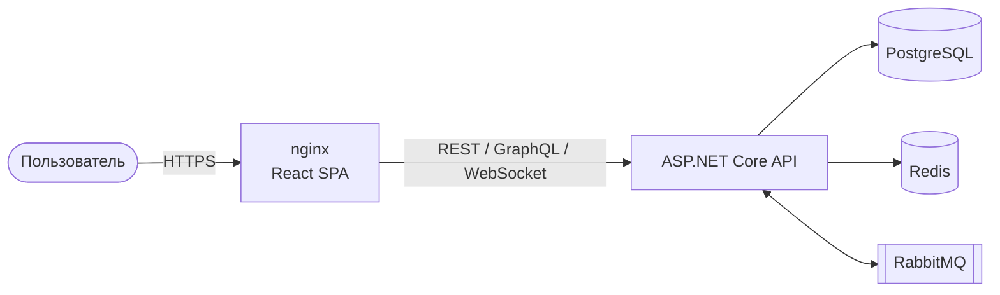
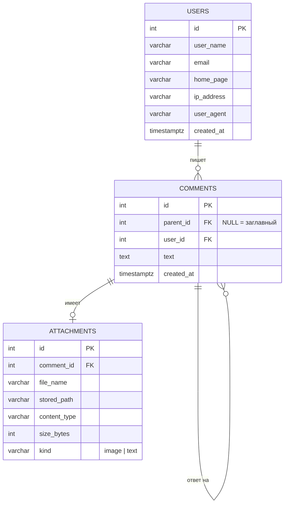
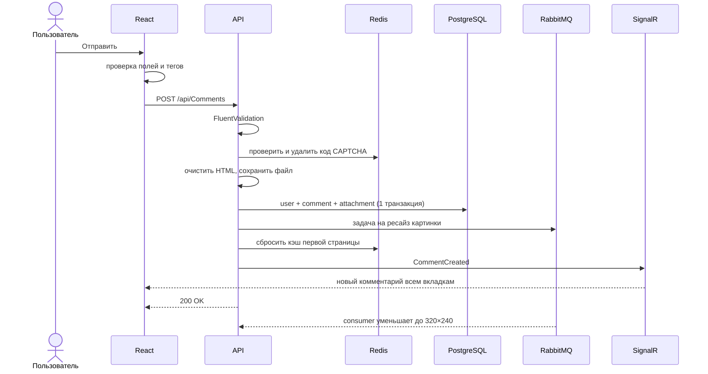
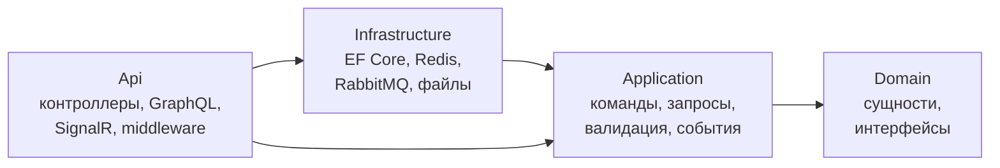
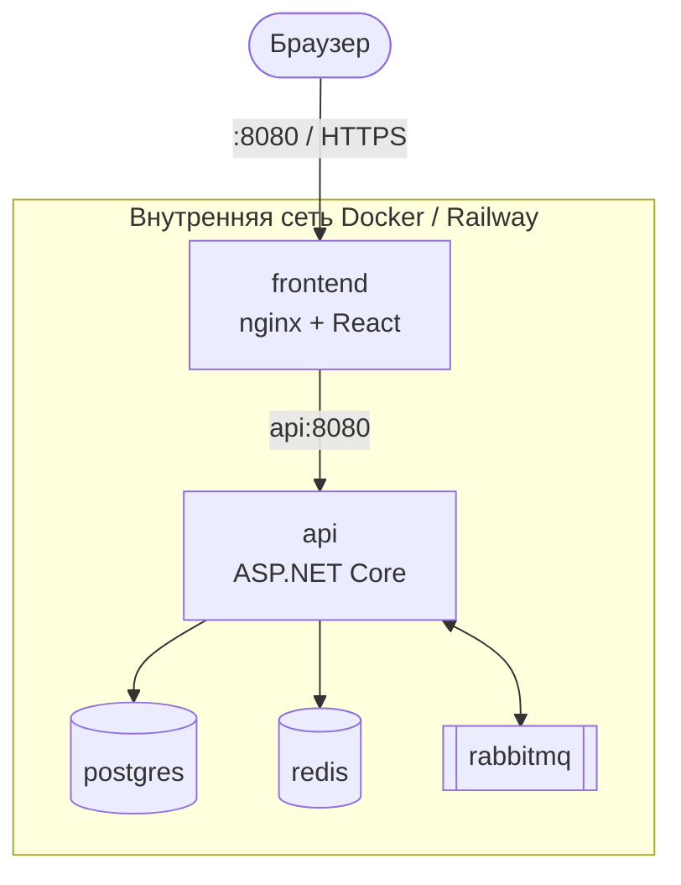

# CommentsApp — Software Requirements Specification (SRS)

| | |
|---|---|
| **Продукт** | CommentsApp — SPA-приложение «Комментарии» |
| **Версия документа** | 1.0 |
| **Дата** | 15.10.2026 |
| **Автор** | Ivan |
| **Статус** | Реализовано, релиз v1.0 |
| **Репозиторий** | [github.com/Ivan072005/CommentsApp](https://github.com/Ivan072005/CommentsApp) |
| **Демо** | [frontend-production-52a2.up.railway.app](https://frontend-production-52a2.up.railway.app) |

---

## Содержание

1. [Введение](#1-введение)
2. [Общее описание](#2-общее-описание)
3. [Функциональные требования](#3-функциональные-требования)
4. [Нефункциональные требования](#4-нефункциональные-требования)
5. [Внешние интерфейсы](#5-внешние-интерфейсы)
6. [Модель данных](#6-модель-данных)
7. [Сценарии использования](#7-сценарии-использования)
8. [Архитектура и развёртывание](#8-архитектура-и-развёртывание)
9. [Матрица трассировки](#9-матрица-трассировки)
10. [Критерии приёмки](#10-критерии-приёмки)

---

## 1. Введение

### 1.1 Назначение

Документ описывает требования к веб-приложению CommentsApp. Он нужен:

- **разработчику** — чтобы знать, что и с каким качеством реализовать;
- **проверяющему** — чтобы сверить готовое приложение с требованиями;
- **тестировщику** — как основа для тест-кейсов.

### 1.2 Область применения

CommentsApp — одностраничное приложение, где пользователи оставляют комментарии и отвечают на них без ограничения вложенности. Комментарии поддерживают ограниченный набор HTML-тегов и вложения: картинки и текстовые файлы. Новые комментарии появляются у всех пользователей в реальном времени.

Регистрации и авторизации нет: пользователь определяется по e-mail.

### 1.3 Термины и сокращения

| Термин | Значение |
|---|---|
| **Заглавный комментарий** | комментарий без родителя (`parent_id = NULL`), показывается в таблице |
| **Ответ** | комментарий с родителем; ответы образуют дерево |
| **Вложение** | файл к комментарию: картинка (JPG/GIF/PNG) или TXT |
| **CAPTCHA** | картинка с кодом для защиты от ботов |
| **SPA** | Single Page Application — страница не перезагружается |
| **LIFO** | Last In, First Out — новые сверху |
| **XSS** | Cross-Site Scripting — внедрение вредоносного скрипта |
| **TTL** | Time To Live — время жизни записи в кэше |
| **DTO** | Data Transfer Object — объект для передачи данных клиенту |

### 1.4 Источники

- Тестовое задание dZENcode «SPA-приложение: Комментарии» (Junior+ / Middle).
- [README.md](../README.md) — запуск и обзор проекта.
- [TECHNOLOGIES.md](TECHNOLOGIES.md) — технологии и решения.

---

## 2. Общее описание

### 2.1 Контекст продукта



### 2.2 Основные функции

| # | Функция |
|---|---|
| 1 | Добавление комментария с CAPTCHA |
| 2 | Ответы на комментарии без ограничения вложенности |
| 3 | Таблица заглавных комментариев: сортировка, пагинация |
| 4 | Ограниченный HTML и панель тегов, предпросмотр |
| 5 | Вложения: картинки с автоуменьшением, TXT-файлы |
| 6 | Просмотр вложений в Lightbox |
| 7 | Обновления в реальном времени |
| 8 | Документация API (Scalar, GraphQL IDE) |

### 2.3 Пользователи

| Роль | Описание | Что делает |
|---|---|---|
| **Посетитель** | любой человек без регистрации | читает, пишет комментарии и ответы, прикладывает файлы |
| **Разработчик / проверяющий** | технический пользователь | смотрит API в Scalar и GraphQL, запускает проект в Docker |

### 2.4 Ограничения

| # | Ограничение |
|---|---|
| C-1 | Backend — C# / ASP.NET Core |
| C-2 | Реляционная БД; схема БД предоставляется файлом (в т.ч. для MySQL Workbench) |
| C-3 | Фронтенд — SPA |
| C-4 | Разрешённые HTML-теги: `<a href="" title="">`, `<code>`, `<i>`, `<strong>` |
| C-5 | Картинки: JPG, GIF, PNG; уменьшение до 320×240 с сохранением пропорций |
| C-6 | TXT-файл не больше 100 КБ |
| C-7 | Секреты (пароли, ключи) не хранятся в репозитории |

### 2.5 Допущения

- Пользователь с тем же e-mail считается тем же человеком.
- Редактирование и удаление комментариев не требуется.
- Одновременно работает один экземпляр API.

---

## 3. Функциональные требования

Приоритет: **M** — must (обязательно по заданию), **S** — should (Junior+ / Middle).

### 3.1 Добавление комментария

| ID | Требование | Приоритет |
|---|---|---|
| **FR-1** | Форма содержит поля: User Name*, E-mail*, Home page, CAPTCHA*, Текст* (`*` — обязательные) | M |
| **FR-2** | User Name — только латинские буквы и цифры | M |
| **FR-3** | E-mail проверяется на корректный формат | M |
| **FR-4** | Home page — необязательный корректный URL (http/https) | M |
| **FR-5** | CAPTCHA генерируется на сервере картинкой; код одноразовый, действует 5 минут; картинку можно обновить | M |
| **FR-6** | Все поля проверяются на клиенте **и** на сервере; ошибки показываются под соответствующим полем | M |
| **FR-7** | Пользователь не дублируется: ищется по e-mail, имя, сайт, IP и User-Agent обновляются | M |
| **FR-8** | Для каждого комментария сохраняются IP-адрес и User-Agent отправителя | M |
| **FR-9** | Имя и e-mail автора запоминаются в браузере и подставляются при следующем визите | S |

### 3.2 Текст и HTML

| ID | Требование | Приоритет |
|---|---|---|
| **FR-10** | Разрешены только теги `<a href title>`, `<code>`, `<i>`, `<strong>`; всё остальное экранируется | M |
| **FR-11** | Проверяется, что теги закрыты и вложены правильно (валидный XHTML) | M |
| **FR-12** | В ссылках допускаются только схемы `http` и `https` | M |
| **FR-13** | Панель `[i] [strong] [code] [a]` оборачивает выделенный текст в тег | M |
| **FR-14** | Предпросмотр комментария без перезагрузки страницы, с теми же правилами очистки HTML | M |

### 3.3 Вложения

| ID | Требование | Приоритет |
|---|---|---|
| **FR-15** | К комментарию можно приложить один файл: JPG, GIF, PNG или TXT | M |
| **FR-16** | Картинка больше 320×240 пропорционально уменьшается до этих размеров | M |
| **FR-17** | TXT-файл больше 100 КБ отклоняется | M |
| **FR-18** | Картинка проверяется декодированием; файл сохраняется под случайным именем (GUID) | M |
| **FR-19** | Вложения открываются в Lightbox с анимацией, закрываются по Esc | M |
| **FR-20** | Уменьшение картинки выполняется в фоне через очередь сообщений | S |

### 3.4 Просмотр комментариев

| ID | Требование | Приоритет |
|---|---|---|
| **FR-21** | Заглавные комментарии выводятся таблицей | M |
| **FR-22** | Сортировка по User Name, E-mail и дате, по возрастанию и убыванию | M |
| **FR-23** | 25 комментариев на страницу, пагинация | M |
| **FR-24** | Сортировка по умолчанию — LIFO (новые сверху) | M |
| **FR-25** | Ответы образуют дерево без ограничения вложенности | M |
| **FR-26** | Ветки ответов загружаются по клику, показывается число ответов | S |
| **FR-27** | Ответить можно на любой комментарий, форма открывается под ним | M |

### 3.5 Реальное время

| ID | Требование | Приоритет |
|---|---|---|
| **FR-28** | Новый комментарий появляется у всех открытых вкладок без перезагрузки | S |
| **FR-29** | Новый ответ появляется в открытой ветке, счётчик ответов обновляется | S |
| **FR-30** | Если пользователь не на первой странице или в другой сортировке, показывается уведомление «новые комментарии» вместо перестройки таблицы | S |
| **FR-31** | В шапке отображается статус соединения (Live / подключение / офлайн), соединение восстанавливается автоматически | S |

### 3.6 API

| ID | Требование | Приоритет |
|---|---|---|
| **FR-32** | REST API для создания комментария, списка, ответов и CAPTCHA | M |
| **FR-33** | GraphQL API для списка комментариев и дерева ответов | S |
| **FR-34** | Интерактивная документация REST API (Scalar) | S |

---

## 4. Нефункциональные требования

### 4.1 Безопасность

| ID | Требование | Как достигается |
|---|---|---|
| **NFR-1** | Защита от XSS | белый список тегов на сервере, экранирование остального текста, только http/https в ссылках |
| **NFR-2** | Защита от SQL-инъекций | только параметризованные запросы EF Core |
| **NFR-3** | Защита от ботов | одноразовая CAPTCHA с TTL 5 минут в Redis |
| **NFR-4** | Безопасные файлы | проверка типа и размера, перекодирование картинок, GUID-имена, `X-Content-Type-Options: nosniff` |
| **NFR-5** | Защита от тяжёлых GraphQL-запросов | ограничение глубины — 15 уровней |
| **NFR-6** | Секреты вне репозитория | `.env`, `appsettings.Development.json` в `.gitignore`; в Git только шаблоны |

### 4.2 Производительность

| ID | Требование | Как достигается |
|---|---|---|
| **NFR-7** | Быстрая первая страница | кэш Redis (cache-aside), TTL 1 минута, сброс при новом комментарии |
| **NFR-8** | Нет N+1 при загрузке дерева | DataLoader: один SQL-запрос на уровень вложенности |
| **NFR-9** | Сортировка и пагинация на стороне БД | `ORDER BY` + `LIMIT/OFFSET`, индексы по `created_at`, `user_name`, `email`, `parent_id` |
| **NFR-10** | Ответ на создание комментария не ждёт ресайза | ресайз в фоне через RabbitMQ |

### 4.3 Надёжность

| ID | Требование | Как достигается |
|---|---|---|
| **NFR-11** | Атомарное сохранение | пользователь, комментарий и вложение — одна транзакция |
| **NFR-12** | Задачи ресайза не теряются | durable-очередь, persistent-сообщения, ручной ack |
| **NFR-13** | Работа при недоступной очереди | fallback: синхронный ресайз |
| **NFR-14** | Единый формат ошибок | `400 { Errors: [{ Field, Message }] }`, `500` без деталей реализации |
| **NFR-15** | Корректное время | даты в UTC (`timestamptz`), отображение в часовом поясе браузера |

### 4.4 Удобство и совместимость

| ID | Требование |
|---|---|
| **NFR-16** | Адаптивная вёрстка: корректно на телефонах и десктопе |
| **NFR-17** | Современные браузеры: Chrome, Firefox, Edge, Safari (последние версии) |
| **NFR-18** | Понятные сообщения об ошибках на русском языке |

### 4.5 Сопровождение и развёртывание

| ID | Требование |
|---|---|
| **NFR-19** | Clean Architecture на бэкенде, Feature-Sliced Design на фронтенде |
| **NFR-20** | Весь стек запускается одной командой `docker compose up -d --build` |
| **NFR-21** | Конфигурация через переменные окружения, один образ для всех сред |
| **NFR-22** | Git: `main` — релизы, `develop` — разработка, `feature/*` — задачи |

---

## 5. Внешние интерфейсы

### 5.1 Пользовательский интерфейс

```
┌──────────────────────────────────────────────────────────┐
│  Комментарии                                    ● Live   │
├──────────────────────────────────────────────────────────┤
│  Новый комментарий                                       │
│  [User Name*]   [E-mail*]   [Home page]                  │
│  [i] [strong] [code] [a]                  Предпросмотр   │
│  ┌────────────────────────────────────────────────────┐  │
│  │ Текст*                                             │  │
│  └────────────────────────────────────────────────────┘  │
│  [Выбрать файл]   [CAPTCHA ↻] [код*]      [Отправить]    │
├──────────────────────────────────────────────────────────┤
│  User Name ↕ │ E-mail ↕ │ Дата ↓ │ Комментарий           │
│  ...         │ ...      │ ...    │ ... ▸ 3 ответа        │
├──────────────────────────────────────────────────────────┤
│                 ‹  1  2  3  ›                            │
└──────────────────────────────────────────────────────────┘
```

### 5.2 REST API

| Метод | Адрес | Описание |
|---|---|---|
| `GET` | `/api/Captcha` | новая CAPTCHA: `{ id, imageDataUri }` |
| `GET` | `/api/Comments?page&pageSize&sortBy&descending` | заглавные комментарии |
| `GET` | `/api/Comments/{id}/replies` | прямые ответы |
| `POST` | `/api/Comments` | создать комментарий (`multipart/form-data`) |
| `GET` | `/uploads/{file}` | загруженный файл |
| `GET` | `/scalar` | документация API |

### 5.3 GraphQL API

Эндпоинт `/graphql`, запросы `comments(page, pageSize, sortBy, descending)` и `replies(parentId)`. У каждого комментария есть поле `replies` любой глубины, но не глубже 15 уровней.

### 5.4 Real-time интерфейс

SignalR-хаб `/hubs/comments`. Сервер шлёт клиентам событие `CommentCreated` с объектом комментария, тем же, что отдают REST и GraphQL.

### 5.5 Программные интерфейсы

| Система | Назначение |
|---|---|
| PostgreSQL 17 | хранение данных |
| Redis 7 | коды CAPTCHA, кэш |
| RabbitMQ 3 | очередь `image-resize` |

---

## 6. Модель данных



- Удаление каскадное: удаление комментария удаляет его ответы и вложения.
- Схема: [`db/init.sql`](../db/init.sql) (PostgreSQL), [`db/mysql/schema.sql`](../db/mysql/schema.sql) и [`db/mysql/comments_app.mwb`](../db/mysql/comments_app.mwb) (MySQL Workbench).

---

## 7. Сценарии использования

### UC-1. Оставить комментарий

| | |
|---|---|
| **Актор** | Посетитель |
| **Предусловие** | Страница открыта, CAPTCHA загружена |
| **Основной поток** | 1. Заполняет поля и текст. 2. При желании прикладывает файл. 3. Вводит код CAPTCHA. 4. Нажимает «Отправить». 5. Комментарий появляется первым в таблице у всех пользователей. |
| **Альтернативы** | 4a. Ошибка в поле → сообщение под полем, данные формы сохраняются. 4b. Неверная CAPTCHA → сообщение, код нужно ввести заново. |
| **Постусловие** | Комментарий сохранён, кэш первой страницы сброшен, картинка поставлена в очередь на уменьшение |



### UC-2. Ответить на комментарий

| | |
|---|---|
| **Актор** | Посетитель |
| **Основной поток** | 1. Нажимает «Ответить» у комментария. 2. Под ним открывается форма. 3. Заполняет и отправляет. 4. Ответ появляется в ветке, счётчик ответов растёт у всех. |
| **Альтернатива** | Родительский комментарий не найден → ошибка 400. |

### UC-3. Просмотреть комментарии

| | |
|---|---|
| **Актор** | Посетитель |
| **Основной поток** | 1. Открывает страницу — видит 25 последних. 2. Меняет сортировку или страницу. 3. Раскрывает ветку ответов. 4. Открывает картинку или TXT в Lightbox. |

---

## 8. Архитектура и развёртывание

### 8.1 Слои бэкенда



### 8.2 Развёртывание



| Среда | Как запускается |
|---|---|
| Локально | `docker compose up -d --build` → http://localhost:8080 |
| Демо | Railway, те же Dockerfile → https://frontend-production-52a2.up.railway.app |

---

## 9. Матрица трассировки

| Требование | Реализация |
|---|---|
| FR-1…FR-6 | `AddCommentForm`, `validation.ts`, валидатор команды (FluentValidation), `ValidationBehavior` |
| FR-5 | `CaptchaService` (ImageSharp + Redis), `useCaptcha` |
| FR-7, FR-8 | `CreateCommentCommandHandler`, Forwarded Headers |
| FR-10…FR-12 | `CommentSanitizer` (сервер), `htmlTags.ts`, `isSafeUrl` (клиент) |
| FR-13, FR-14 | `TagToolbar`, `sanitizeForPreview` |
| FR-15…FR-18 | `FileStorageService`, ImageSharp |
| FR-19 | `Lightbox`, `AttachmentList` |
| FR-20 | `RabbitMqImageResizeQueue`, `ImageResizeConsumer` |
| FR-21…FR-24 | `GetCommentsQueryHandler`, `CommentsTable`, `Pagination` |
| FR-25, FR-26 | GraphQL `replies`, `RepliesByParentIdDataLoader`, `RepliesBranch` |
| FR-28…FR-31 | `CommentCreatedEvent`, `BroadcastCommentCreatedHandler`, `CommentsHub`, `realtime.ts` |
| FR-32…FR-34 | контроллеры, HotChocolate, Scalar |
| NFR-7 | `CommentsCache`, `InvalidateCommentsCacheHandler` |
| NFR-14 | `ExceptionHandlingMiddleware` |
| NFR-20 | `docker-compose.yml`, Dockerfile, `nginx.conf` |

---

## 10. Критерии приёмки

- [x] Комментарий с корректными данными сохраняется и появляется первым в таблице.
- [x] Неверная CAPTCHA, имя с кириллицей, неверный e-mail → ошибка под полем.
- [x] `<script>alert(1)</script>` отображается как текст и не выполняется.
- [x] Незакрытый тег `<strong>текст` не даёт отправить комментарий.
- [x] Ссылка `javascript:` не сохраняется как активная.
- [x] Картинка 1920×1080 уменьшается до 320×180 (с сохранением пропорций).
- [x] TXT больше 100 КБ отклоняется.
- [x] Сортировка по имени, e-mail и дате работает в обе стороны; 25 записей на страницу.
- [x] Ответ на ответ на ответ отображается в дереве.
- [x] Комментарий из одной вкладки появляется во второй без перезагрузки.
- [x] Повторный e-mail не создаёт нового пользователя.
- [x] `docker compose up -d --build` поднимает весь стек; приложение доступно на :8080.
- [x] Scalar и GraphQL IDE открываются и выполняют запросы.
